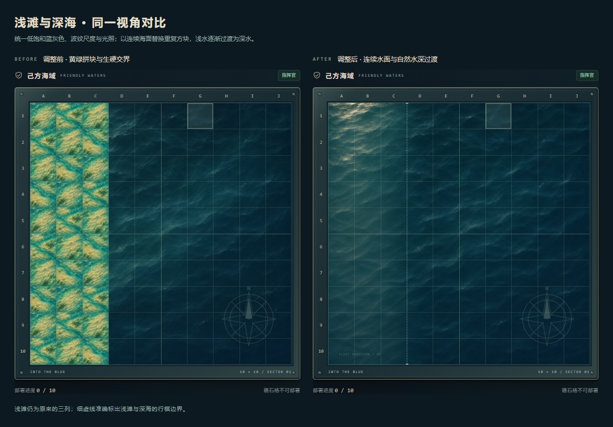

# 浅滩与深海的材质统一 · v3.1

此文保留 v3.1 修订记录。v3.2 将同一原则扩展到全部地图，图鉴改为整图并撤下细节图集；当前实现见 [完整海图修订](unified-map-art.md)。

## 问题分析

截图中的违和感由三件事叠加造成：

1. **色调与亮度脱节。** 浅滩大片黄绿色和明亮沙纹抢走了注意力，深海则是低亮度的石油蓝；看起来像两张来自不同场景的素材。
2. **纹理尺度不一致。** 深海是一幅连续海面，浅滩却把四张独立插画缩进每个格子再重复铺排，产生重复沙丘、过密波纹和接缝。
3. **水深没有过渡。** 逐格贴图在第三、四列之间直接切换，形成一条材料断面，缺少沙床逐渐没入水下的感觉。

原先只保证了单张地块的细节，没有验证它们连成整片海域后的材质一致性。

## 修正

- 以项目原有的 `art-source/ocean-original.png` 为编辑基准，通过内置 imagegen 分别生成浅水在左和浅水在右的完整海域。两幅图分别绘制，均保留左上方光照，避免简单镜像导致光线反向。
- 浅滩改为低饱和蓝灰浅水，水下沙床只做轻微提示；沿用深海的波纹方向、细节尺度与明暗关系。
- 棋盘与地图预览使用完整连续海域，消除逐格重复。浅水在约一格宽的区域内自然过渡至深水。
- 细虚线和端点刻度准确标注原来的浅滩边界。画面可以柔和过渡，部署、移动、搁浅与鱼雷判定仍读取原有地形数组。
- 从同一幅新版浅海画面裁取四个细节，统一地形图鉴、图例和地图标识中的浅滩材质。



## 文件与导出

| 文件 | 用途 |
| --- | --- |
| `art-source/coast-west-v2.png` | 浅水位于左侧的完整原图 |
| `art-source/coast-east-v2.png` | 浅水位于右侧的完整原图 |
| `public/assets/coast-west-v2.webp` | 左侧浅滩网页素材，56,314 字节 |
| `public/assets/coast-east-v2.webp` | 右侧浅滩网页素材，77,460 字节 |
| `public/assets/shoal-variants-v2.webp` | 同材质的四种细节缩略，11,380 字节 |
| `scripts/prepare-coast.py` | 机械缩放、细节裁切与 WebP 编码 |

新增三张网页素材共 145,154 字节，全部十张网页素材共 382,214 字节（约 373 KiB）。原始图片保留；导出时运行 `python scripts/prepare-coast.py`，需要 Pillow。运行游戏无需 Python。

## 验证

- 地图与地形的桌面 / 手机浏览器回归通过，包含创建房间、布阵、航行、触礁、搁浅、炮弹、鱼雷与地形图鉴。
- 验证所有新增背景图片能完整解码，浅滩边界标线与真实单元格边缘对齐。
- 在相同视角保存空棋盘的修改前后截图，另外检查有舰船、搁浅标记与 390px 手机画面。
- 规则与联机测试共 26 项；构建包含新素材。

## 最终生成提示词

使用内置 imagegen 的编辑模式，两次独立调用；编辑参考均为 `art-source/ocean-original.png`，输出不透明图片。没有用代码对素材进行调色或绘画，Python 脚本仅用于缩放、裁切和编码。

### 左侧浅滩

```text
Use case: stylized-concept. Edit the provided ocean artwork into a unified, high-quality coastal sea background for a naval tactics board, preserving its semi-realistic hand-painted miniature style. The reference is the established sea material: dark desaturated petroleum navy, fine small wavelets with a few warm ivory glints from upper-left light, gentle diagonal currents. Match that material and wave scale everywhere in this edited image. This is one continuous SQUARE straight-down orthographic sea surface, not a tile atlas. No grid, no lines, no divisions, no repeated squares, no UI. The entire canvas is WATER; there is no coast above water, no dry sand, no islands or exposed rocks. The shallow water should be subdued blue-gray teal, with only faint cool gray-beige sand ripples visible far BELOW the same water surface, sparse soft underwater caustics. The sand must look submerged, its visibility gently lost in deeper water. Shallows should be only moderately lighter than the deep water, about 20 to 35 percent, with matching low saturation. No vivid yellow, golden stripe, lime, emerald, tropical turquoise, dense vegetation, sharp seabed ridges or coral. Do not fill shallow water with large repetitive mounds or gold caustics. Avoid a dramatic shore break, white surf line, waterfall, cliff or foam at the depth transition. Preserve upper-left illumination and the reference's fine waves across the WHOLE image, flowing uninterrupted across the depth gradient. The deep region should retain the original dark sea's look and quiet detail, with no visible seam. Finely painted, calm, believable, restrained. No ships, labels, text, compass, markers or borders. Spatial layout: the LEFTMOST 0 to 24 percent of the canvas is shallow sea; between x=24% and x=36% the submerged pale sand fades gradually and organically beneath progressively deeper blue water. From x=36% all the way to the RIGHT EDGE is the original dark deep sea. The depth band extends the full image height; its soft organic boundary averages x=30% with very small natural undulations. Preserve the original deep ocean at the right and a continuous shared water surface. The left edge remains water, never land.
```

### 右侧浅滩

```text
Use case: stylized-concept. Edit the provided ocean artwork into a unified, high-quality coastal sea background for a naval tactics board, preserving its semi-realistic hand-painted miniature style. The reference is the established sea material: dark desaturated petroleum navy, fine small wavelets with a few warm ivory glints from upper-left light, gentle diagonal currents. Match that material and wave scale everywhere in this edited image. This is one continuous SQUARE straight-down orthographic sea surface, not a tile atlas. No grid, no lines, no divisions, no repeated squares, no UI. The entire canvas is WATER; there is no coast above water, no dry sand, no islands or exposed rocks. The shallow water should be subdued blue-gray teal, with only faint cool gray-beige sand ripples visible far BELOW the same water surface, sparse soft underwater caustics. The sand must look submerged, its visibility gently lost in deeper water. Shallows should be only moderately lighter than the deep water, about 20 to 35 percent, with matching low saturation. No vivid yellow, golden stripe, lime, emerald, tropical turquoise, dense vegetation, sharp seabed ridges or coral. Do not fill shallow water with large repetitive mounds or gold caustics. Avoid a dramatic shore break, white surf line, waterfall, cliff or foam at the depth transition. Preserve upper-left illumination and the reference's fine waves across the WHOLE image, flowing uninterrupted across the depth gradient. The deep region should retain the original dark sea's look and quiet detail, with no visible seam. Finely painted, calm, believable, restrained. No ships, labels, text, compass, markers or borders. Spatial layout: the RIGHTMOST 76 to 100 percent of the canvas is shallow sea; between x=64% and x=76% the submerged pale sand fades gradually and organically beneath progressively deeper blue water. From the LEFT EDGE through x=64% is the original dark deep sea. The depth band extends the full image height; its soft organic boundary averages x=70% with very small natural undulations. Preserve the original deep ocean at the left and a continuous shared water surface. The right edge remains water, never land. Keep the lighting from UPPER LEFT as in the reference; do NOT mirror or flip the lighting.
```
