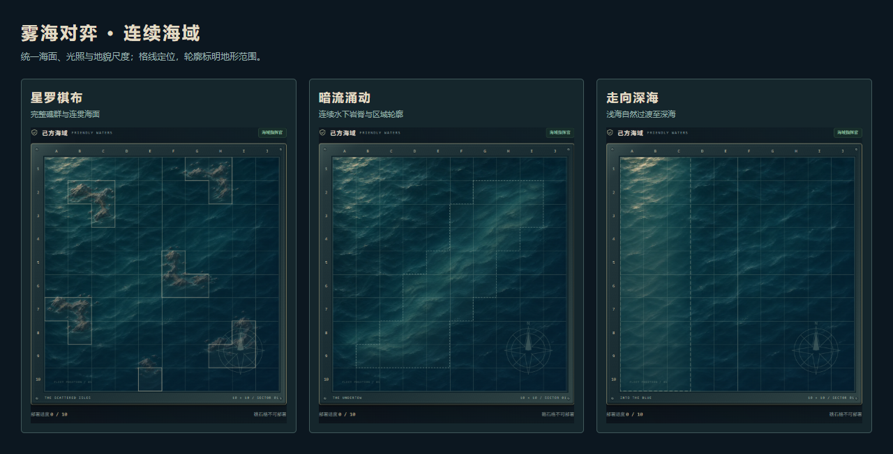
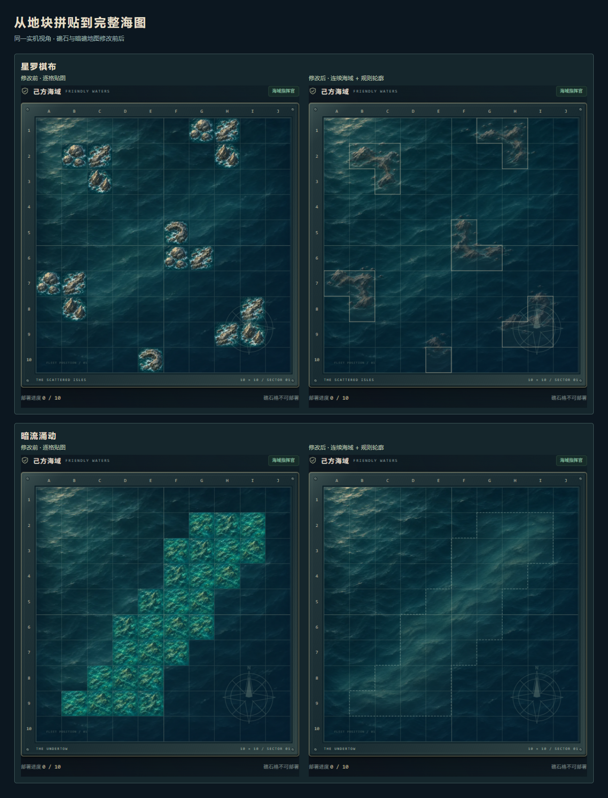

# 完整海图与统一地貌 · v3.2

## 问题与原则

v3.1 只修正了浅滩的重复贴图，礁石和暗礁仍把独立插画放进每个格子，产生重复轮廓、材料接缝和互不相连的岩体。图鉴与地图预览也在展示地块，而不是完整海域。

本次采用“先绘制整幅海图，再叠加规则网格”的方式。海浪、光照和地貌连续；10 × 10 格线用于定位，区域轮廓明确标出地形生效范围。



## 调整内容

- **星罗棋布**：绘制六组自然礁群，组成形状各异的岩脊、岩台和小型离礁。海浪与泡沫沿整个礁群流动，内部不再按格子切换素材。
- **暗流涌动**：将独立的暗礁块连为一条完整的水下岩脊，岩层透过同一海面隐约可见，边缘渐隐于深海。
- **走向深海**：保留 v3.1 连续浅海与深海渐变，改用与其他地图相同的整图渲染及规则轮廓。
- **共同材质**：全部以原有海面为参考，保持低饱和石油蓝、细波纹、灰褐岩石与左上光照。两侧礁石、暗礁海图分别绘制，采用相反的地形布局，光源保持一致。
- **可读性**：礁石禁航区用细实线，暗礁触礁区用短虚线，浅滩搁浅区用长虚线。相邻同类格子的内部边界不重复描线。自然绘画负责地貌，区域轮廓准确限定规则范围。
- **预览与图鉴**：均复用完整海图；图例中的小图直接显示整图局部。移除“每类四种地块”展示与旧网页图集。



## 渲染与规则

每个棋盘只使用一个覆盖全域的背景画面，未给单个格子设置背景图。独立 SVG 区域轮廓直接从 `terrainFor` 的 100 格规则数组生成，合并相邻格子的外缘。真实部署、移动、触礁、搁浅与鱼雷判定继续使用原规则数据。

空间参考图由 `scripts/prepare-map-layouts.mjs` 根据公开地形生成，仅用于指导完整绘画的位置。AI 绘画具有自然、柔和的轮廓，准确的可操作范围以实线 / 虚线圈定的格子为准。

## 原图与网页素材

| 原图 | 网页完整海图 | 大小 |
| --- | --- | ---: |
| `art-source/chart-archipelago-0-v3.png` | `public/assets/chart-archipelago-0-v3.webp` | 90,216 字节 |
| `art-source/chart-archipelago-1-v3.png` | `public/assets/chart-archipelago-1-v3.webp` | 100,976 字节 |
| `art-source/chart-undertow-0-v3.png` | `public/assets/chart-undertow-0-v3.webp` | 81,544 字节 |
| `art-source/chart-undertow-1-v3.png` | `public/assets/chart-undertow-1-v3.webp` | 80,920 字节 |

浅滩沿用 `art-source/coast-{west,east}-v2.png` 与对应 WebP。完整海图导出仅缩放与 WebP 编码，不进行逐格裁切、调色或代码绘画。运行 `python scripts/prepare-charts.py`，需要 Pillow。浅滩可运行 `python scripts/prepare-coast.py`；游戏运行无需 Python。

四张新海图共 353,656 字节。撤下旧 `terrain-atlas.webp` 和 `shoal-variants-v2.webp`，所有十二张网页素材总计 644,894 字节，约 630 KiB。原有图集源文件保留为历史存档。

## 验证

- 26 项规则及 HTTP 双客户端测试通过。
- 地形浏览器检查通过：布阵拒绝、移动、炮弹 / 鱼雷、触礁、搁浅与整图图鉴。
- 舰船与棋盘美术回归通过：拖拽、旋转、火焰、残骸、手机和平板布局。
- `npm run check:charts`：验证四张地图、双方朝向、新图完整解码，棋盘无单格背景图及旧图集请求。在 1440、768、390px 屏宽下，以每格中心和四个内角共五个采样点检查地形轮廓与规则范围一致。
- 实机截图保留在浏览器检查输出目录；`scripts/chart-report.mjs` 将同一视角截图排成对比报告。

## 生成模式与完整提示词

使用内置 imagegen **编辑模式**，共四次独立调用；未使用 CLI 或外部图包。每次的 Image 1 是对应 `art-source/map-layouts/{map}-{side}.png` 空间参考图，Image 2 是 `art-source/ocean-original.png` 材质与光照参考。全部输出不透明。两侧使用相同提示词与不同空间图，保持同一光源。

### 礁石海图（两侧各一次）

```text
Use case: precise-object-edit. Asset: ONE continuous SQUARE, straight-down orthographic sea chart painting for the naval tactics game FOGBOUND. Image 1 is a SPATIAL GUIDE: its flat rounded colored marks indicate approximate landform locations only. Image 2 is the established sea material and upper-left lighting reference. Preserve the reference's dark desaturated petroleum navy, subdued blue-gray teal, very fine diagonal wavelets, warm ivory glints, semi-realistic hand-painted miniature style and calm, restrained value range. Preserve the ocean's coherent wave scale and lighting over the ENTIRE canvas. Replace all flat guide shapes with believable organic landforms integrated into one natural seascape. The output must be a single cohesive natural map painting, NEVER a tile atlas or a collection of separate square illustrations. Remove every trace of diagram geometry: no square patches, rounded squares, tiled textures, grid lines, straight block edges, outlines, map symbols or text. No ships, UI, compass, borders, labels, watermarks. Every unmarked area must stay open deep water. Do not add new terrain locations. Keep upper-left lighting, never flip the light. Match the ocean reference closely outside the marked terrain. The ivory guide marks form SIX small ROCKY ISLET GROUPS, occupying a total of about 16 percent of the image. Turn adjoining marks into continuous irregular clusters with connected slender rock spines, ledges and small detached outcrops, smoothly spanning the internal imaginary cell boundaries. Each group's footprint must remain confined to the combined marked cells, without spreading into open-water cells; keep coastlines slightly inset from each outer footprint. Keep each marked cell's center occupied by visible rock. Vary silhouettes organically: rugged slate-gray rock, muted gray-brown stone faces, restrained pale rim foam and tiny wet ledges. These are very low bare rocks protruding above water, not green tropical islands or beaches. Sparse foam swirls join the shared wave field around the contours, without circular badges or isolated square backdrops. Do not repeat identical rock shapes at each mark: adjacent marks become a single geographic feature. Natural connected geography in ONE unified ocean painting. Keep all six groups where the guide places them, including groups at the canvas edges.
```
### 暗礁海图（两侧各一次）

```text
Use case: precise-object-edit. Asset: ONE continuous SQUARE, straight-down orthographic sea chart painting for the naval tactics game FOGBOUND. Image 1 is a SPATIAL GUIDE: its flat rounded colored marks indicate approximate landform locations only. Image 2 is the established sea material and upper-left lighting reference. Preserve the reference's dark desaturated petroleum navy, subdued blue-gray teal, very fine diagonal wavelets, warm ivory glints, semi-realistic hand-painted miniature style and calm, restrained value range. Preserve the ocean's coherent wave scale and lighting over the ENTIRE canvas. Replace all flat guide shapes with believable organic landforms integrated into one natural seascape. The output must be a single cohesive natural map painting, NEVER a tile atlas or a collection of separate square illustrations. Remove every trace of diagram geometry: no square patches, rounded squares, tiled textures, grid lines, straight block edges, outlines, map symbols or text. No ships, UI, compass, borders, labels, watermarks. Every unmarked area must stay open deep water. Do not add new terrain locations. Keep upper-left lighting, never flip the light. Match the ocean reference closely outside the marked terrain. The teal guide marks define ONE long connected SUBMERGED REEF BANK crossing diagonally from the lower-left toward the upper-right. Replace that complete chain of marks with one meandering natural underwater ridge, seamlessly connected across the imaginary cell divisions. The bank is entirely beneath the water surface. Paint faint cool slate and gray-green rock strata, submerged ridges and soft silt channels seen through the SAME fine sea wavelets. Let water depth blend gently over the bank's outer edge while its footprint closely follows the marked zone; preserve deep navy water outside. The center of the bank may be 20 to 30 percent lighter than the open water, never bright tropical turquoise, yellow or lime. Do not create one rock pile per mark, individual islands, repeated mounds, cells, separate patches or exposed stone: this is ONE continuous submerged geological formation, soft natural edges and irregular internal rock structure. No coral colors or vegetation. Match the reference's surface wave texture and upper-left light everywhere. Keep the exact broad location and slope of the marked bank.
```
